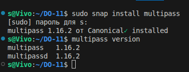

## Part 0. ПОДГОТОВКА. Создание трёх виртуальных машин


> Для задания нужны именно ВМ, а не Docker-контейнеры. Самый простой способ на Ubuntu — Multipass (это утилита от Canonical, она создаёт лёгкие Ubuntu-ВМ через KVM в пару команд).

> Multipass по умолчанию использует QEMU/KVM на Linux — это значит, что ВМ будут запускаться через аппаратную виртуализацию, без оверхеда (overhead — накладные расходы) на эмуляцию.




**Создаём три ВМ**


**# Мастер-узел: 2 ядра, 2 ГБ ОЗУ, 15 ГБ диска**

**# Первый воркер**

**# Второй воркер**


**Проверка, что все три ВМ поднялись**


## Part 1.  Установка k3s *

## 1) Отчет содержит список команд для установки дистрибутива Kubernetes k3s на трех удаленных виртуальных машинах. *


**Заходим в ВМ мастера:**


**Ставим k3s без Traefik (по заданию)**

- Что делает эта команда:

    1) curl -sfL — скачивает скрипт установки (-s тихо, -f падать при ошибке, -L следовать редиректам)
    2) sh -s - — выполнить скачанное через bash и передать дальше аргументы
    3) --disable=traefik — не ставить Traefik (мы поставим Nginx позже)
    4) --write-kubeconfig-mode 644 — сделать kubeconfig (файл с настройками доступа к кластеру) читаемым обычным пользователем, иначе придётся каждый раз через sudo


**IP мастера**


```
s@Vivo:~/DO-11$ MASTER_IP=$(multipass info k3s-master | grep IPv4 | awk '{print $2}')
echo $MASTER_IP
10.174.8.95
```


**Токен для подключения воркеров**

```
ubuntu@k3s-master:~$ sudo cat /var/lib/rancher/k3s/server/node-token
K102a0844657ffcb3fa8e62ae92a742a9124d6b274346696ea625e70efa10ee391a::server:0d0768b3a3f9e758aec953c04b3e26d9
```


**На воркерах**

- Заходим на первый воркер:

- Запускаем установку k3s в режиме агента (воркера). 

- Подставляем IP мастера и токен:


**Команда для установки k3s в режиме агента (воркера)**

```
curl -sfL https://get.k3s.io | K3S_URL=https://10.174.8.95:6443 K3S_TOKEN=K102a0844657ffcb3fa8e62ae92a742a9124d6b274346696ea625e70efa10ee391a::server:0d0768b3a3f9e758aec953c04b3e26d9 sh -
```


**worker1**


**worker2**


- Здесь:

    - K3S_URL — адрес API-сервера мастера (порт 6443 — стандартный для Kubernetes API)
    - K3S_TOKEN — тот самый токен, который мы получили на мастере
    - Когда указаны эти переменные, скрипт ставит k3s в режиме агента, а не сервера


1) МАСТЕР (первый узел):
   - команда БЕЗ K3S_URL и K3S_TOKEN
   - запускается как "сервер"
   - создаёт кластер

2) ВОРКЕР (следующие узлы):
   - команда С K3S_URL и K3S_TOKEN
   - запускается как "агент"
   - подключается к существующему кластеру


>  А можно ли установить k3s на воркере так же, как на мастере?

>  Технически — да, но это будет ошибка.

> - Установится k3s в режиме сервера
> - Он создаст свой собственный кластер на этом узле
> - Этот узел не подключится к твоему мастеру
> - В итоге: у будет 1 мастер + 2 изолированных сервера, которые не работают вместе


## 2) Обратите внимание, что Kubernetes не содержит стандартный контроллер Ingress Traefik. *


**Проверка**


**Со всеми тремя узлами в Ready.**


**Все системные поды (CoreDNS, metrics-server, local-path-provisioner). Главное — там не должно быть Traefik, потому что я его отключил.**

**Traefik действительно отключён, как требует задание!**


<br>


**Настройка kubectl на хосте**

- Чтобы не заходить каждый раз в ВМ мастера, скопировал kubeconfig на свой хост:

**kubectl get nodes**


<br>
<br>
<br>


## Part  2. Настройка контроллера Ingress

## 1) Контроллер Ingress на основе nginx настраивается в кластере.


## 2) Отчет содержит его конфигурацию и команды, необходимые для настройки контроллера.


<br>
<br>
<br>


    3. Kubernetes и тесты

1) В Kubernetes создан постоянный том для базы данных PostgreSQL.
2) Приложение развернуто в Kubernetes и доступно по адресу кластера.
3) Предоставлены скриншоты результатов теста Postman.


<br>
<br>
<br>


    4. Оператор Prometheus

1) Отчет содержит описание запуска оператора Prometheus и скриншоты результатов.

    0 1 2 3 4 5


<br>
<br>
<br>


## Part 1. Развертывание собственного кластера k3s

### Задание

1. Получить набор виртуальных машин для кластера.

2. Установить k3s на всех трех машинах. При установке не использовать стандартный Ingress Controller при помощи флага `--disable=traefik`.

3. Выполнить подключение узлов к кластеру, используя команду `k3s server` и флаги `--token` и `--server` для рабочих узлов и мастера соответственно. Когда k3s установлен, можно использовать переменную окружения `NODE_TOKEN`.

4. Установить Ingress Controller Nginx вместо стандартного. Ты можешь использовать официальный файл манифеста Ingress контроллера на базе Nginx, доступный на GitHub.

5. Получить доменное имя и сконфигурировать внутри кластера утилиту `cert-manager`, которая должна генерировать wildcard-сертификат для полученного домена.

6. Создать ресурс Ingress для своего личного домена и настроить его для использования контроллера nginx ingress и полученного сертификата.

7. Создать PV (Persistent Volume) для базы данных PostgreSQL в манифесте из десятого проекта.

8. Запустить приложение, описанное в манифесте.

9. Запустить функциональные тесты Postman и удостовериться в работоспособности приложения.

10. Установить и запустить Prometheus Operator для сбора метрик в системе. Продемонстрировать в отчете результат выполнения команды `kubectl get pods -n monitoring`.
